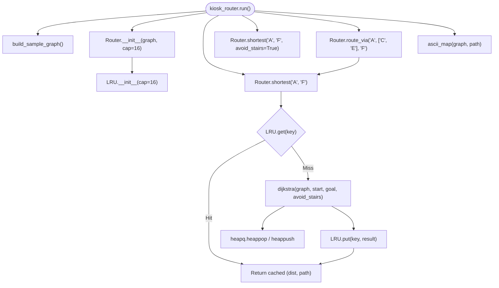

# Scenario 5: Legacy Code Analysis (`kiosk_router.py`)

## Executive Summary (3-Sentence Note)
`kiosk_router.py` is a self-contained 2023 prototype navigation engine that bundles an in-memory graph representation, Dijkstra/BFS routing algorithms, a custom doubly-linked-list LRU cache, and an ASCII map renderer. It caches query results using string keys like `f"{s}:{t}:{avoid_stairs}"`, evicting the least recently accessed route when the capacity threshold is reached. While functional for offline kiosk terminal exports, its single-letter variable names, lack of error types, and code duplication make retiring it in favor of `campusroute.routing` (CR-9) essential for maintainability.

---

## 1. Five-Part Structural Map of `kiosk_router.py`

| Part | Component | Line Range | Purpose |
|---|---|---|---|
| **1** | `_N` & `LRU` | Lines 16–92 | Custom O(1) Least-Recently-Used (LRU) cache combining a Python `dict` (`self.m`) with a doubly linked list (`_N` nodes with `prev` and `next` pointers) and sentinel head/tail nodes. |
| **2** | `Graph` | Lines 94–142 | Campus graph structure storing nodes, coordinate positions `(x, y)`, and bidirectional weighted edges `(u, v, meters, stairs)`. |
| **3** | `bfs` & `dijkstra` | Lines 144–205 | Core pathfinding implementations: unweighted BFS returning shortest hop counts, and Dijkstra using `heapq` with lazy deletion for metric shortest paths. |
| **4** | `Router` | Lines 207–285 | High-level facade wrapping `Graph` and `LRU`. Resolves queries, checks cache, invokes Dijkstra, formats turn directions, and handles `via` waypoints. |
| **5** | `ascii_map` & `run` | Lines 287–339 | Demo CLI execution: solves sample queries, prints metrics, prints cache hit/miss statistics, and generates a terminal ASCII grid representation. |

---

## 2. LRU Cache & `Router.shortest` Analysis

### Cache Architecture (`LRU.get` and `LRU.put` lines 49–75)
- **Hash Map (`self.m`):** Maps query key strings to `_N` node references for O(1) lookup.
- **Doubly Linked List:** Maintains recency ordering. Most recently used items are spliced directly after dummy head `self.h`; least recently used items reside immediately before dummy tail `self.t`.
- **Eviction:** When `len(self.m) >= self.cap`, `self.t.p` (the node before tail) is unlinked from the list, deleted from the dictionary, and returned as the evicted key.

### Caching Behavior for Edge Cases
- **Unreachable Routes:** When two nodes have no valid path, `dijkstra()` returns `(math.inf, [])`. `Router.shortest` caches this result under the key `f"{s}:{t}:{avoid_stairs}"`. Subsequent queries for unreachable targets hit the cache without re-running Dijkstra.
- **Node Not in Graph:** If start node `s` or target node `t` is missing from `graph.nodes`, `dijkstra` returns `(math.inf, [])`. The call succeeds without crashing, but caches `(math.inf, None)` or empty paths rather than raising domain exceptions like `UnknownPlaceError`.

---

## 3. Call-Flow Diagram

---

## 4. CR-9 Retirement & Migration Strategy
To retire `kiosk_router.py`:
1. Redirect kiosk export scripts from `campusroute.legacy.kiosk_router.Router` to `campusroute.routing.shortest_route`.
2. Wrap `shortest_route` with `functools.lru_cache(maxsize=128)` or application-level cache if kiosk hardware benefits from query caching.
3. Replace raw string IDs with `Campus.resolve()` for alias matching and suggestion support.
4. Safely deprecate and archive `app/campusroute/legacy/kiosk_router.py`.
